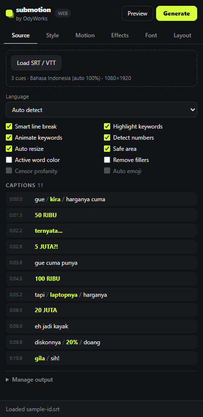
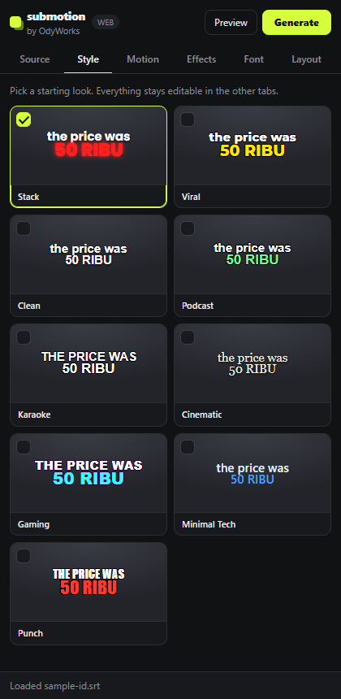
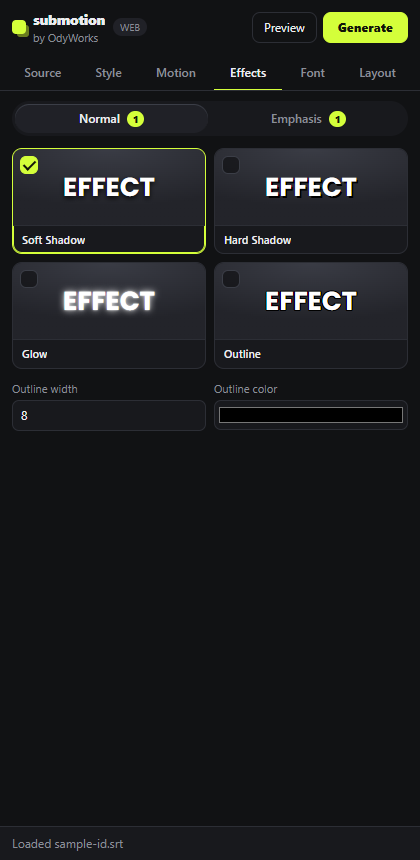

# SubMotion by OdyWorks

**Turn entire subtitles into editable, animated captions in one click: no manual keyframing or layout work.**

SubMotion is a panel for **Adobe After Effects** and **Adobe Premiere Pro**. Load an SRT/VTT, pick a
style, click **Generate**. SubMotion splits the text into punchy captions, detects keywords and
numbers, lays everything out inside the safe area, and builds animated captions that stay fully
editable. Bahasa Indonesia and English are first-class languages.

**Free and open source (MIT).** Windows 10/11 (x64), After Effects and/or Premiere Pro 2022 or newer
(tested on 2024). macOS is not supported yet.

[**Download Windows beta →**](https://github.com/jordylf/SubMotion/releases/tag/v0.1.0) · [Installation](#install) · [Premiere workflow](#premiere-pro)

## Panel preview

Load subtitles, choose a look, then generate editable captions in Adobe.

| Import & smart captions | Choose a visual style | Customize word effects |
| :---: | :---: | :---: |
| [](docs/screenshots/source.png) | [](docs/screenshots/styles.png) | [](docs/screenshots/effects.png) |

Screenshots show the actual panel running in browser preview with the included
[Indonesian sample](docs/samples/sample-id.srt). In Adobe, the badge changes to **AE** or **PR** and
transcription and timeline generation become available. Click an image to view it full size.

1. **Import or transcribe** — load SRT/VTT, or select a clip and transcribe its audio locally.
2. **Choose your look** — pick a preset and adjust Normal and Emphasis word styling.
3. **Preview → Generate** — create the first five examples, then process the full subtitle sequence.

For example, Indonesian spoken numbers become emphasized values:

```
"gue kira harganya cuma lima puluh ribu ternyata lima juta"
  →  Gue kira harganya cuma │ 50 RIBU │ Ternyata... │ 5 JUTA?!
```

## Features (implemented)

- **Sources:** SRT and WebVTT files (both apps). In AE you can also use selected text layers,
  including one layer with Source Text keyframes.
- **Transcribe directly from video/audio** with local **Whisper** (whisper.cpp). It's offline and free,
  and gives **real word-level timing**: select a clip and click *Transcribe selected clip*.
  Only the trimmed part of the clip is transcribed. See [Transcription](#transcription-whisper).
- **Smart splitting:** optimal segmentation by dynamic programming. It respects punctuation, pauses,
  reading speed, word/char limits and function words, and isolates strong keywords for impact.
- **Languages:** auto-detect, Bahasa Indonesia, English. Each language module has its own fillers,
  particles, contrast/reveal words and emotional lexicon.
- **Numbers:** `lima puluh ribu → 50 RIBU`, `satu koma lima juta → 1,5 JUTA`, `lima juta rupiah → Rp5 JUTA`,
  `five thousand dollars → $5,000`, `twenty percent → 20%`. Style is `auto`/`compact`/`full`.
  The rules are conservative: `satu hal` and `one of them` stay as words, and years stay as written.
- **Keyword scoring (0–100):** numbers, currency, percentages, emotional words, strong verbs, CAPS,
  `!`/`?`, repetition, and sentence-final words. The top words per caption get the emphasis style.
- **Filler removal (opt-in, conservative):** hesitation sounds (`eh`, `eee`, `hmm`, `um`) always go.
  Discourse fillers (`kayak`, `gitu`, `kan`, `you know`, `like`, `basically`) go only when
  comma-isolated. `mukanya kayak artis` is untouched.
- **Normal vs Emphasis styles:** each word class has its own font, size, color, animation,
  intensity and effects (soft shadow, hard shadow, glow, outline).
- **Animations:** Pop, Bounce, Fade, Slide Up, Scale, Punch, Shake, Typewriter, Blur Reveal and Snap.
  **Motion control:** *Speed* (duration) and *Velocity* (ease sharpness).
- **Lines & words:** max lines, max words per line, words per caption, line spacing (below 1
  overlaps lines), word spacing, max width, vertical position.
- **Emphasis control:** keyword threshold, *Emphasis in every caption*, *Whole phrase* emphasis,
  and *Emphasis on its own line* (the stacked look).
- **Active-word highlight (karaoke color)**, word-by-word or whole-caption reveal.
- **Layout:** upper/middle/lower placement, safe margins plus a social-UI safe zone for vertical
  video, balanced 1–N line breaks, and auto-resize to max width (AE re-measures real glyphs).
- **9 JSON presets:** Stack, Viral, Clean, Podcast, Karaoke, Cinematic, Gaming,
  Minimal Tech, Punch.
- **Non-destructive:** originals are never touched. Generate replaces the previous SubMotion output,
  and *Delete Generated* removes it.
- **Long videos:** batched host calls with a progress bar and Cancel. Processing is cached
  between preview and generate.

## How it works in each app

**After Effects**: SubMotion adds a `SubMotion Captions` comp to your active comp. Each caption is a
precomp, and **every word is its own text layer**. Animation is procedural (expressions reading a
`SubMotion Controls` null), so there are no keyframes. Change the animation, intensity or colors on
the Controls null and every caption updates. Edit any word like normal text. Toggle emphasis by
setting a word's marker comment to `emph` or `normal`.

**Premiere Pro**: Premiere's APIs can't read caption tracks or create animated text, so SubMotion
offers two outputs: an **After Effects comp linked through Dynamic Link** (full styling, needs After
Effects) or one **Motion Graphics template clip per caption** (lighter, edited in the Essential
Graphics panel). See [Premiere Pro](#premiere-pro) below.

See [docs/ARCHITECTURE.md](docs/ARCHITECTURE.md) for the API audit and design decisions.

## Install

1. Download `SubMotion-<version>.zxp` from the **[Releases](../../releases)** page.
2. Install it with a free ZXP installer, e.g. **[ZXP Installer by aescripts](https://aescripts.com/learn/zxp-installer/)**:
   open the installer and drag the `.zxp` file onto it.
3. Restart After Effects / Premiere Pro, then open **Window › Extensions › SubMotion** (in newer
   Premiere versions: **Window › Extensions (Legacy) › SubMotion**).

The first time you transcribe a clip, SubMotion asks to download what transcription needs, once:
the speech model (about 550 MB, from Hugging Face) and FFmpeg (about 165 MB, from its GitHub releases).
whisper.cpp is already included. Nothing you transcribe leaves your computer.

To update, install the newer `.zxp` the same way. To uninstall, use the installer's *Remove* button.

### After Effects quick start
1. Open the comp you want captions in. If no comp is active, SubMotion creates a 1080×1920 one.
2. *Load SRT / VTT*, or select text layers and click *Selected text layers*.
3. Pick a Caption Style and click **Preview** (first 5 captions), then **Generate Subtitles**.

### Premiere Pro
Premiere's scripting API cannot create animated text, so SubMotion has two outputs (*Premiere output*
on the Source tab):

**After Effects comp via Dynamic Link (default).** Needs After Effects installed.
1. In After Effects, make sure no project with **unsaved changes** is open (save or close it, or just
   quit AE; SubMotion starts it when needed). SubMotion never touches a project with unsaved changes.
2. In Premiere: open your sequence → SubMotion → transcribe the selected clip or load an SRT → **Generate**.
3. SubMotion drives After Effects over BridgeTalk: it opens its own project
   `Documents\SubMotion\SubMotion_<sequence>.aep`, builds the captions there (same word layers and
   Controls as the AE mode), saves it, then links the `SubMotion Captions` comp into a "SubMotion" bin
   and places it on a free video track at 0.
4. Edit captions in After Effects (Edit Original); Premiere updates through Dynamic Link. Generate again
   replaces the clip and the link.

**Motion Graphics template (.mogrt).** Lighter, edited in the Essential Graphics panel, but one font
per caption and no per-word shadow/glow (the template's look comes from the preset it was built with).
The templates ship in `assets/mogrt/` (`SubMotion_Caption_1080x1920.mogrt`, `..._1920x1080.mogrt`).
To rebuild them: open a **saved** After Effects project → SubMotion → *Manage output › Build Premiere
template* (it saves the project, because After Effects only exports from a project without unsaved
changes), or `npm run build:template` with After Effects open. After Effects exports asynchronously, so
SubMotion waits until each .mogrt zip is complete before copying it.

Template sliders are limited to 0–100 in Premiere, so: **Speed** 50 = normal (25 = half, 75 = double),
**Emphasis Size +%** = extra size of emphasis words (25 = 1.25×), **Size %** relative to a 200 px base.

## Transcription (Whisper)

SubMotion runs [whisper.cpp](https://github.com/ggml-org/whisper.cpp) and FFmpeg locally. whisper.cpp
ships inside the extension (`bin/win`). FFmpeg, the speech model (`ggml-large-v3-turbo-q5_0.bin`, good
for Indonesian and English) and a small voice-activity model are downloaded once, on first use, into
`%APPDATA%\SubMotion` (models are checked against their SHA-256).

Select a footage layer (AE) or a clip in the timeline (Premiere), set *Language*
(Auto / Indonesia / English), and click **Transcribe selected clip**. The words land in the caption
list with exact timing, ready for Preview / Generate. Only the trimmed part of the clip is transcribed.
Trimmed, offset and time-stretched (AE) or speed-changed (Premiere) clips map correctly; reversed and
time-remapped clips are rejected. On a typical CPU, transcription takes roughly 2–4× the clip length.

*Transcription setup* (Source tab) can point SubMotion at your own `whisper-cli.exe`, model or
ffmpeg instead; leave the fields empty to use the automatic ones (shown in gray).

## Development

Requirements: Node 22.6+ and After Effects / Premiere Pro on Windows.

```bash
npm install
npm run build
```
Allow unsigned extensions once (per CEP version), then link the folder into the CEP extensions
directory (run `cmd` from the `submotion` folder):
```bash
reg add HKCU\Software\Adobe\CSXS.11 /v PlayerDebugMode /t REG_SZ /d 1 /f
```
```bash
reg add HKCU\Software\Adobe\CSXS.12 /v PlayerDebugMode /t REG_SZ /d 1 /f
```
```bash
mklink /J "%APPDATA%\Adobe\CEP\extensions\com.submotion" "%CD%"
```
`npm run fetch:bins` downloads the bundled whisper.cpp (pinned, checksum-verified) into `bin/win`. Releases: see [docs/RELEASING.md](docs/RELEASING.md).


```bash
npm test            # unit tests (Node test runner, no Adobe needed)
npm run typecheck   # tsc --noEmit
npm run check:jsx   # syntax + ES3 check for ExtendScript files
npm run verify:ae   # runs the real AE host code in the OPEN After Effects (temporary comps, removed after)
                    # and prints every expression's error status + sampled values. Optional: -- viral
npm run watch       # rebuild the panel on change
```
Open `src/ui/index.html` in a browser (served from the project root) to use the panel in
*browser preview* mode. Splitting, keywords and the preview list work there, but host buttons do
not. To debug inside Adobe, use Chrome at `localhost:8089` (AE) or `localhost:8088` (Premiere); see `.debug`.

```
submotion/
  CSXS/manifest.xml        CEP manifest (PPRO + AEFT)
  src/core/                host-independent TypeScript engines + pipeline + host adapter contract
  src/languages/id-ID|en-US language packs
  src/after-effects/host.jsx  AE adapter (ExtendScript)
  src/premiere/host.jsx       Premiere adapter (ExtendScript)
  src/host/main.jsx        ExtendScript entry: JSON bridge, loads the right adapter
  src/core/transcript/     whisper JSON parsing, media→timeline mapping, word cues, SRT export
  src/ui/                  panel (HTML/CSS/TS, bundled to dist/panel.js); transcriber.ts runs Whisper
  presets/*.json           built-in presets
  tests/                   unit tests
  docs/                    architecture, sample SRTs
```

## Presets

A preset is a **partial** JSON object merged over `DEFAULT_PRESET` (`src/core/preset-engine/index.ts`),
so a preset only lists what it changes:

```json
{
  "id": "my-style", "name": "My Style",
  "font": "Poppins-Bold", "fallbackFonts": ["Arial-BoldMT"],
  "fontSize": 76, "textColor": "#FFFFFF", "animation": "snap", "normalShadow": true,
  "emphasisFont": "Poppins-ExtraBold", "emphasisSizeMul": 1.45, "keywordColor": "#FF1F1F",
  "emphasisAnimation": "punch", "emphasisGlow": true,
  "lineSpacing": 0.8, "maxLines": 3, "maxWordsPerLine": 3, "stackEmphasis": true
}
```

- `font` is the **PostScript name** (AE: Character panel; the panel falls back through `fallbackFonts`).
- `fontSize` is in px for a 1080-px short side and scales with the frame.
- `animation` / `emphasisAnimation` is one of `pop bounce fade slide-up scale punch shake typewriter blur-reveal snap`.
- Normal vs Emphasis: `font`/`emphasisFont`, `fontSize`/`emphasisSizeMul`, `textColor`/`keywordColor`,
  `intensity`/`emphasisIntensity`, `normalShadow`/`emphasisShadow`, `normalGlow`/`emphasisGlow`.
- Motion: `speed` (%), `velocity` (0–100). Lines: `maxLines`, `maxWordsPerLine`, `lineSpacing`, `wordSpacing`.
- Emphasis: `alwaysEmphasize`, `emphasisScope` (`word|phrase`), `stackEmphasis`.
- Other keys: `caseMode` (`as-is|upper|sentence`), `punctuation` (`keep|minimal`), `position`
  (`upper|middle|lower`), `maxLines`, `maxWidthPct`, `safeMarginPct`, `keywordThreshold`,
  `maxKeywordsPerCaption`, `isolateKeywords`, `dramaticPunctuation`, `activeColor`,
  `activeWordHighlight`, `tracking`.

**Add a built-in preset:** drop a JSON file in `presets/`, import it in
`src/core/preset-engine/index.ts`, and add it to `BUILT_IN`. `validatePreset` rejects bad colors,
unknown animations and impossible word limits, so a community preset can't break the panel.

## Language modules

A language is one `LanguagePack` (`src/core/language-engine/index.ts`) in `src/languages/<locale>/`:
word lists (`common`, `hardFillers`, `softFillers`, `noEnd`, `noStart`, `contrast`, `reveal`,
`emotional`, `strongVerbs`) plus `parseNumber` / `formatNumber`. To add one, implement the pack, register it in
`LANGUAGES`, and add tests with real sentences.

## Contributing

- Keep the core pure: no Adobe or DOM calls in `src/core` or `src/languages`.
- ExtendScript is **ES3**: no `let`/`const`, arrow functions, `JSON` or array helpers.
  `npm run check:jsx` enforces this.
- Every behavior change comes with a test in `tests/`.

## Known limitations

- **Premiere caption tracks can't be read by any Adobe API yet**: transcribe the clip, or export the
  captions as SRT. When UXP adds caption access, a UXP adapter can be added without touching the core.
- **Word timing:** exact when transcribed with Whisper. For SRT/VTT input it is estimated from cue
  timing (proportional to word length).
- **Premiere font:** the template's font is set when it is built in AE. Per-clip font override is
  attempted through the text parameter's `fontEditValue` when Premiere exposes it.
- **Premiere and Normal/Emphasis:** a template is one text layer, so emphasis words get their own
  color, size (via an animator), animation and intensity, but **not** their own font, and shadow/glow
  apply to the whole caption. After Effects supports every per-class setting, since each word is its own layer.
- **Glow** in AE is a zero-distance Drop Shadow in the word's class color. It is cheap to render and
  follows the Emphasis Color control.
- **Premiere dropdown params** are set as 0-based indices (checked on Premiere 2024).
- **Undo:** AE groups each batch as one undo step, and Premiere has no undo-group API. The reliable
  undo for a whole run is **Delete Generated** (or just Generate again).
- **Very long videos in AE:** one layer per word is heavy (a 1-hour podcast is ~9,000 layers).
  It works in batches, but a lighter one-layer-per-caption mode is on the roadmap.
- **Windows only for now.** The bundled whisper.cpp and the release package are Windows x64;
  macOS needs Mac builds of both and a Mac-signed package.
- Adobe-side behavior can't be covered by unit tests; `npm run verify:ae` checks the After Effects
  expressions inside a running AE, and the checklist below covers the rest.

### Manual test checklist (in Adobe)
1. AE: load `docs/samples/sample-id.srt` → Preview → 5 captions appear, words pop in when spoken,
   `50 RIBU` is yellow and punches.
2. AE: change *Animation* on `SubMotion Controls` → all captions change. Edit a word → stays animated.
3. Premiere, Dynamic Link: transcribe a clip → Generate → one linked comp on a free track; Edit
   Original opens it in AE.
4. Premiere, template: switch *Premiere output* → Preview → 5 graphic clips; change Caption text in the
   Essential Graphics panel.
5. Both: Delete Generated removes only SubMotion output.

## Roadmap

- **Phase 1 (this release):** AE + Premiere, ID + EN, SRT/VTT import, local Whisper transcription
  with word timing, smart splitting, keyword + number emphasis, Normal/Emphasis styles, 10 animations
  with speed/velocity, word-by-word reveal, active-word color, layout engine, JSON presets.
- **Phase 2:** profanity filter (ID/EN, replace/asterisks/partial), auto emoji (next to the caption,
  never replacing words), speaker colors/positions (VTT `<v>` speakers are already parsed),
  save/rename/duplicate/import/export presets in the UI (`PresetManager` already supports it),
  background box, sound effect per animation, custom AE `.ffx` animations, one-layer-per-caption AE mode.
- **Phase 3:** optional AI semantic engine (keywords, splitting, rewriting, translation, emoji). It
  plugs in after `scoreKeywords` and can overwrite scores or chunk boundaries. Also an online preset
  marketplace (presets are already plain validated JSON).

User-built Premiere templates in `%APPDATA%\SubMotion\mogrt` take priority over the bundled templates after updates. Delete that override file to use the template included with a newer SubMotion release.
